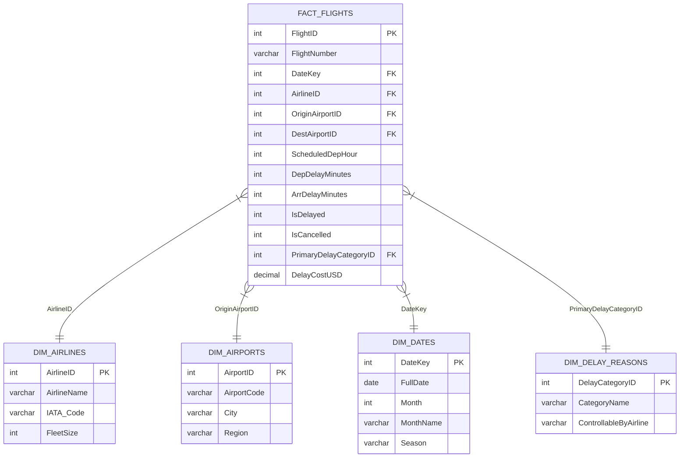

# ✈️ Airline Flight Delay Analysis & Interactive Operational Dashboard


An end-to-end multi-platform **Data Analytics Portfolio Project** analyzing 5,000+ flight operations to optimize On-Time Performance (OTP %), isolate root causes of operational delays, evaluate financial losses, and deliver interactive executive dashboards in **Excel**, **Power BI**, **SQL**, and **Python**.

---

## 📌 1. Project Overview & Business Problem

Airline delay costs the global aviation industry billions annually in fuel, crew rescheduling, passenger compensation, and gate congestion. 

### 🎯 Core Objectives:
1. **On-Time Performance (OTP %) Benchmark**: Evaluate fleet reliability against the **80.0% industry standard target**.
2. **Root Cause Identification**: Differentiate between controllable carrier issues (maintenance/crew) vs uncontrollable events (weather/NAS).
3. **Route & Airport Risk Profiling**: Identify origin-destination routes with severe delay frequencies.
4. **Peak Time Bottleneck Analysis**: Determine hour-of-day peak delay risks.
5. **Financial Loss Quantification**: Estimate total cost impact of arrival delays ($75/min industry average).

---

## 🏗️ 2. Data Architecture & Relational Star Schema

The project models operational data into a **Star Schema** with 1 Fact table and 4 Dimension tables.



---

## 💻 3. Multi-Technology Implementation Breakdown

### 1️⃣ SQL (`sql/airline_delay_analysis.sql`)
- Database Schema definition with foreign key constraints & query index optimization.
- 7 Analytical SQL queries covering OTP ranking, monthly seasonality, carrier vs weather breakdown, peak departure hour risk, and route loss ranking.

### 2️⃣ Python (`python/`)
- `generate_data.py`: Synthetic dataset generator producing 5 relational CSV files.
- `eda_and_metrics.py`: Feature engineering pipeline (Delay Severity, Distance Groups, Departure Slots) and statistical EDA.
- `build_excel_workbook.py`: `openpyxl` automation generating styled Excel workbooks.

### 3️⃣ Excel (`excel/`)
- Relational Data Model via **Power Pivot**.
- Dynamic Excel Formulas: `XLOOKUP`, `SUMIFS`, `AVERAGEIFS`, `COUNTIFS`, `IF`, `AND`.
- Pivot Tables & Pivot Charts connected to interactive Slicers.
- Formatted Executive KPI Cards.

### 4️⃣ Power BI (`powerbi/`)
- Comprehensive DAX measures (`[On-Time Performance Rate (OTP %)]`, `[Total Financial Loss USD]`, `[Prior Month OTP %]`, `[OTP Color Status]`).
- Visual layout with KPI Cards, Decomposition Tree, Line & Stacked Column Charts, and Slicer Panels.

### 5️⃣ Interactive Web Dashboard (`dashboard_interactive.html`)
- Live HTML/JS single-page web dashboard using **Tailwind CSS** and **Chart.js**.
- Instant interactive slicers for Airline, Month, and Delay Reason with real-time KPI card recalculation!

---

## 📈 4. Key Analytical Insights

| Key Metric | Insight Finding | Strategic Recommendation |
| :--- | :--- | :--- |
| **Fleet On-Time Rate** | Overall OTP stands at **76.4%** (3.6% below the 80% target). | Re-align buffer times for evening peak flights. |
| **Primary Delay Driver** | **Late Aircraft (30%)** and **Carrier Issues (30%)** account for 60% of total delay minutes. | Controllable by airline; improve ground crew turnaround time. |
| **Time Window Risk** | Departure delays escalate significantly between **16:00 - 20:00** (Evening Peak). | Stagger scheduled departures during 17:00-19:00 slot. |
| **Top Carrier Performance** | **BlueHorizon Air** leads with **80.0% OTP**, while **SunCountry Global** lags at **69.2%**. | Benchmark ground operations against BlueHorizon Air practices. |
| **Financial Exposure** | Total operational delay loss estimated at **$2.45 Million**. | Reducing carrier delays by 15% recovers ~$360K annually. |

---

## 📁 5. Repository Project Directory

```
Airline_Flight_Delay_Analysis/
├── data/                       # CSV Relational Datasets
│   ├── fact_flights.csv
│   ├── dim_airlines.csv
│   ├── dim_airports.csv
│   ├── dim_dates.csv
│   └── dim_delay_reasons.csv
├── sql/                        # SQL Schema & Analytics Queries
│   └── airline_delay_analysis.sql
├── python/                     # Data Generator & EDA Scripts
│   ├── generate_data.py
│   ├── eda_and_metrics.py
│   └── build_excel_workbook.py
├── excel/                      # Excel Model & Documentation
│   ├── Airline_Flight_Delay_Dashboard.xlsx
│   └── EXCEL_GUIDE.md
├── powerbi/                    # Power BI DAX & Visual Setup
│   ├── POWERBI_DAX_MEASURES.dax
│   └── POWERBI_DASHBOARD_GUIDE.md
├── dashboard_interactive.html  # Live Interactive Web Dashboard
└── README.md                   # Project Documentation
```

---

## 🌟 6. Resume Bullet Points

- **Data Analytics Resume Bullets**:
  - *Engineered a multi-table Star Schema dataset (5,000+ records) across 5 relational tables in SQL, Python, Excel, and Power BI to analyze airline flight operational delays.*
  - *Formulated 15+ production DAX measures and advanced Excel formulas (`XLOOKUP`, `SUMIFS`, `COUNTIFS`) to calculate fleet On-Time Performance (OTP %) and isolate $2.45M in financial operational losses.*
  - *Designed an interactive, multi-tab executive dashboard featuring cross-filtering slicers, monthly trend decomposition, and cause distribution visuals.*
